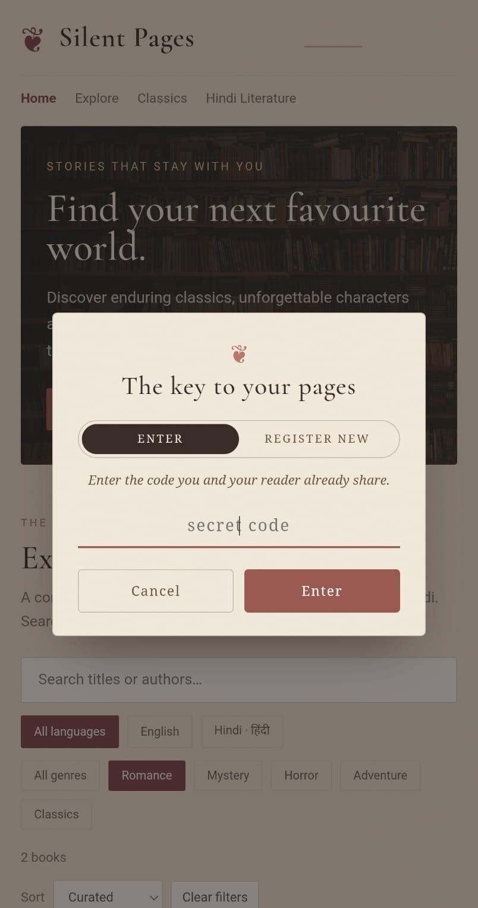
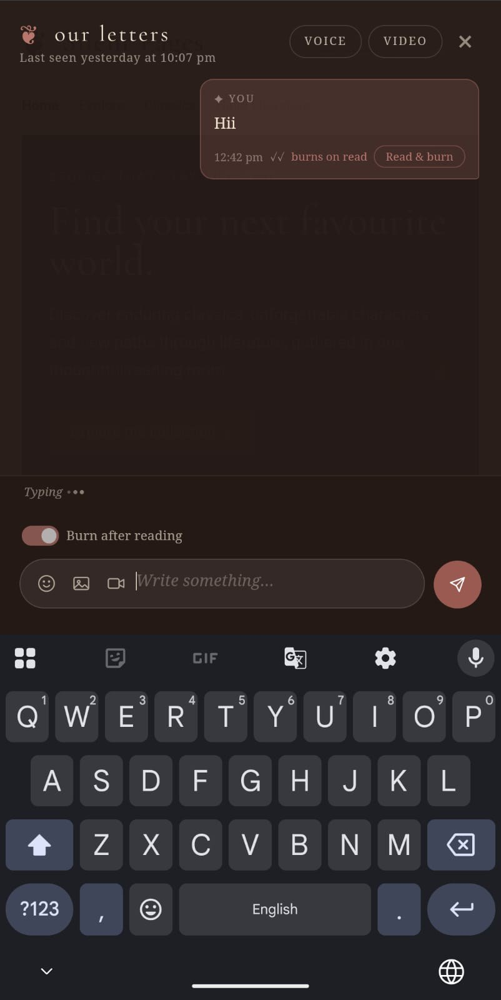
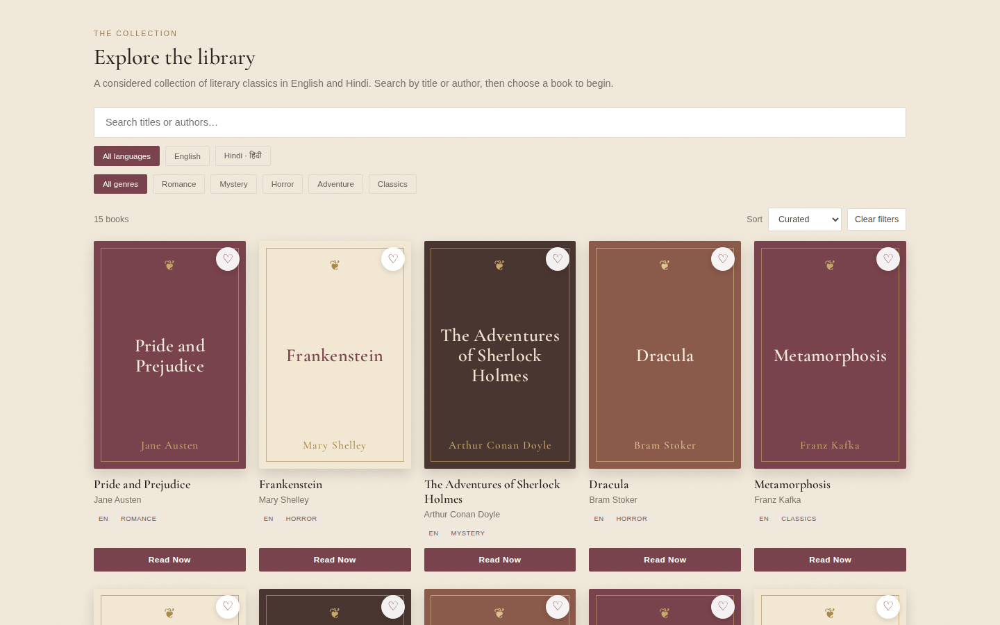
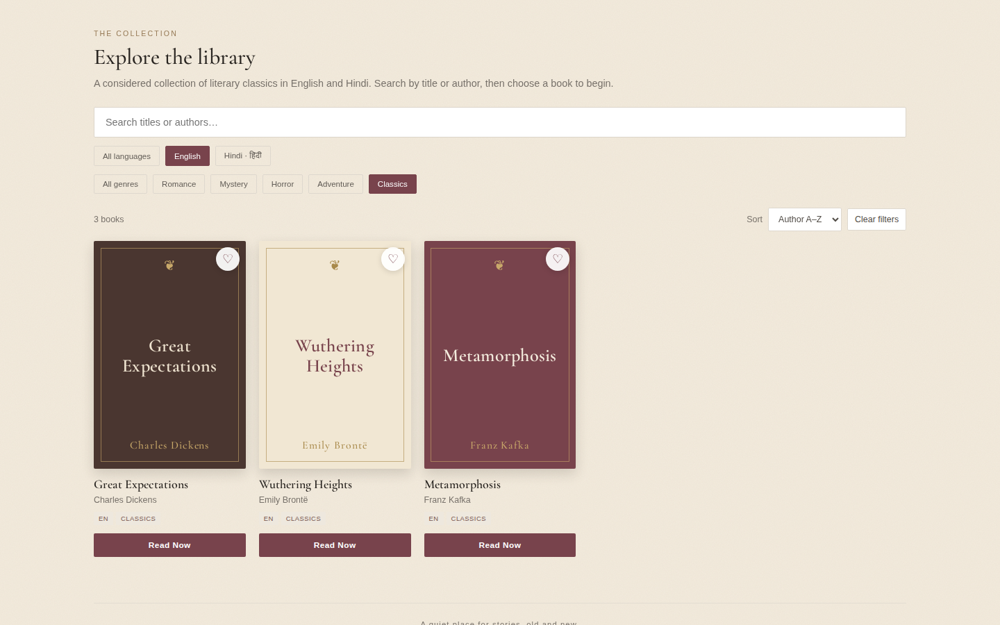
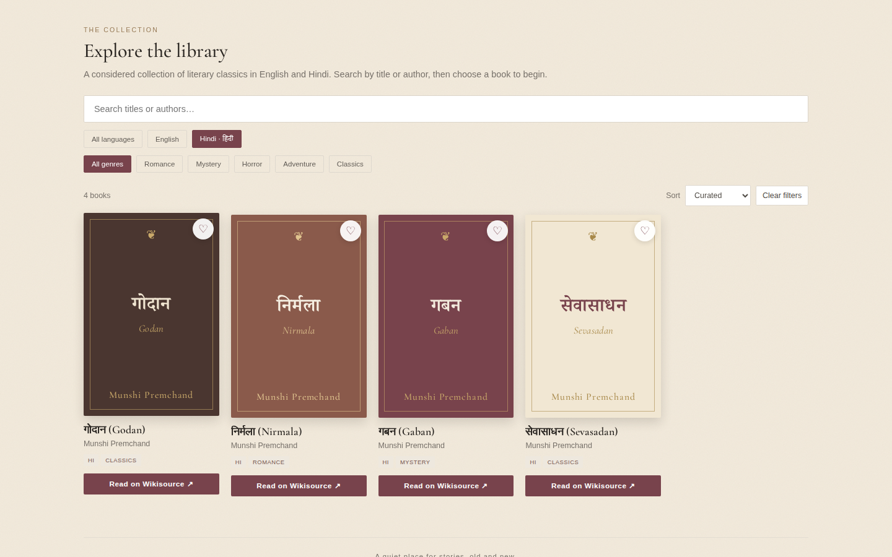
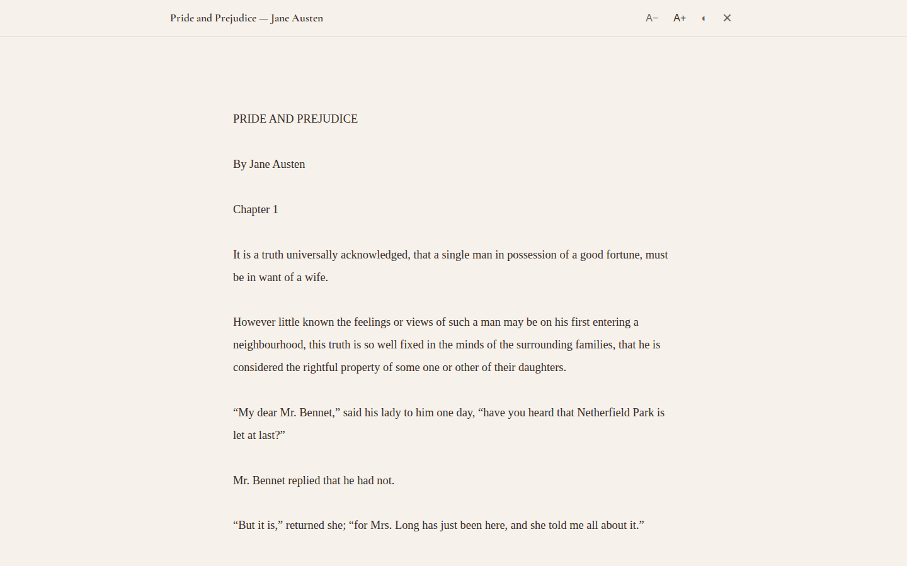
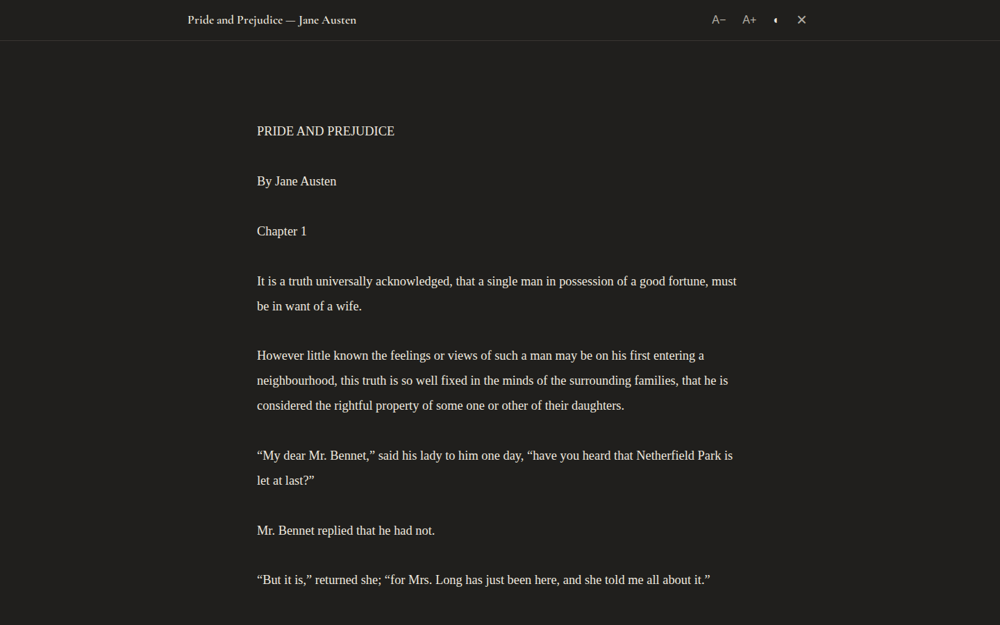
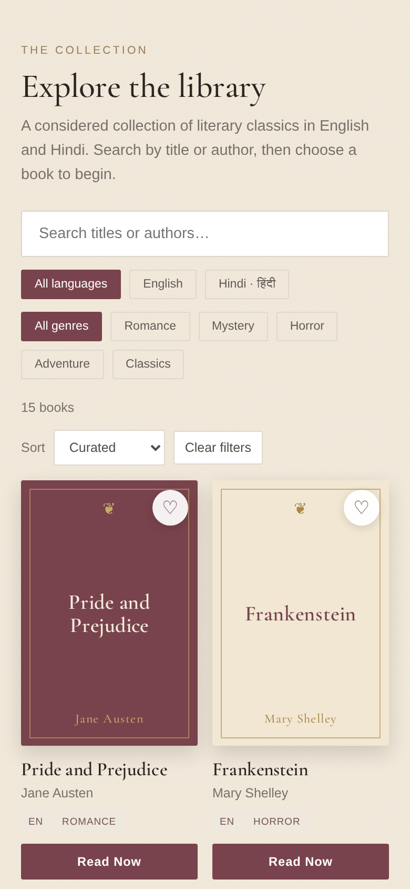

# Silent Pages

**A library for the quietly curious.**
A calm reading room of public-domain classics in English and Hindi, with a **private two-person messaging app hidden behind it**. To anyone else it is just a novel library.


## Features

- **Curated library**: 15 classics (11 English, 4 Hindi) with language and genre filters, title/author search, and Curated / Title A–Z / Author A–Z sorting.
- **Forgiving search**: case- and accent-insensitive for Latin text (`bronte` finds *Brontë*), and Hindi titles can be found by their transliteration (`godan`).
- **Typographic covers**: every cover is generated in CSS from the book's metadata. No hotlinked artwork, so covers never break and carry no copyright risk.
- **In-page reader**: text-size controls, a dark reading theme, Escape to close, and keyboard focus returned to the book you opened. Where a source can't be embedded, the reader falls back to a direct link.
- **Favourites**: saved in the browser's `localStorage`.
- **Responsive and accessible**: two-column mobile grid, visible keyboard focus, `aria-live` result counts, dialog semantics on the reader.
- **Zero build step**: one `index.html`, no framework, no bundler (the chat uses Firebase and Supabase from CDNs).

## The hidden messaging app

Silent Pages is two apps in one page. The public face is the novel library below. Behind it sits a private chat for two people who share a secret code; without the code, nothing about the chat is visible.

| Secret-code prompt | Private chat ("our letters") |
|---|---|
|  |  |

- **Secret-code access**: enter an existing code, or register a new one. The code decides which private room you join.
- **Real-time text chat** (Firebase Firestore) with typing indicator, online presence and "last seen".
- **Burn after reading**: messages can be marked to disappear once read.
- **Media sharing**: photos and videos (Supabase Storage), plus an emoji picker.
- **Replies, reactions, read receipts and deletion.**
- **Voice and video calls** (WebRTC, signalled through Firestore).
- **Disguise**: the library is a fully working reading app, so the page looks ordinary at a glance.

> **Security note.** Message text is only lightly obfuscated in the browser (an XOR with a key derived from the shared code). That keeps it from being casually readable in the database, but it is **not end-to-end encryption**. Real privacy depends on your Firestore and Supabase **security rules**, so review them before sharing the project. The Firebase and Supabase client keys in `index.html` are public by design; the rules are the protection.

## Library screenshots

| Library | Search, filter, sort |
|---|---|
|  |  |

| Hindi literature | Reading interface |
|---|---|
|  |  |

| Dark reading theme | Mobile |
|---|---|
|  |  |

> **About these screenshots.** The two chat images above were taken on a phone by the author (the bottom strip of the code prompt is cropped). The library images were captured with Playwright (headless Chromium) running this repository's `index.html` locally, using `scripts/capture_screenshots.py`. The capture environment had no internet access, so: the hero's hotlinked Unsplash photo did not load (only its dark overlay is visible); fonts were supplied from local files; and the reader shows a short public-domain excerpt served from `scripts/fixtures/` instead of the live Project Gutenberg text. The deployed site shows the hero photo and live book text.

## Quick start

No installation is required. Serve the folder with any static server:

```bash
python3 -m http.server 8000
# open http://localhost:8000
```

## Deployment

The site is fully static and needs no build.

**GitHub Pages**: push to GitHub, then *Settings → Pages → Build and deployment → Deploy from a branch → `main` / `(root)`*. The included `.nojekyll` file disables Jekyll processing.

**Netlify / Cloudflare Pages / Vercel**: no build command; publish directory `.`.

## Project structure

```
silent-pages/
├── index.html                    # The app: markup, styles and scripts
├── screenshots/                  # Real browser captures used in this README
├── scripts/
│   ├── capture_screenshots.py    # Playwright checks + screenshot capture
│   └── fixtures/                 # Offline stand-ins used only by the capture script
├── LICENSE
├── .gitignore
├── .nojekyll
└── README.md
```

## The collection

Books live in the `NOVELS_COLLECTION` array inside `index.html`:

```js
{ id: 'gb-1260', title: 'Jane Eyre', author: 'Charlotte Brontë', lang: 'en',
  genre: 'Romance', type: 'reader', source: 'Project Gutenberg',
  url: 'https://www.gutenberg.org/ebooks/1260.txt.utf-8' }
```

- `type: 'reader'` opens the in-page reader (plain-text Project Gutenberg URL); `type: 'external'` links out to the source site.
- `genre` must match one of the genre filter buttons (Romance, Mystery, Horror, Adventure, Classics), or add a new button.
- Hindi titles use the form `देवनागरी (Transliteration)`; the cover shows both.
- Before adding a book, confirm that the author's work is in the public domain and that the text link works.

**Sources.** English texts come from [Project Gutenberg](https://www.gutenberg.org/); Hindi texts link to [Hindi Wikisource](https://hi.wikisource.org/).

## Testing

```bash
pip install playwright && playwright install chromium
python3 scripts/capture_screenshots.py
```

The script runs 30 checks (rendering, search, filters, sorting, favourites, reader controls, keyboard behaviour, mobile layout, console errors) and rewrites `screenshots/`.

## License

[MIT](LICENSE) © 2026 workbyank. The books themselves are public-domain works linked from their original hosts.
